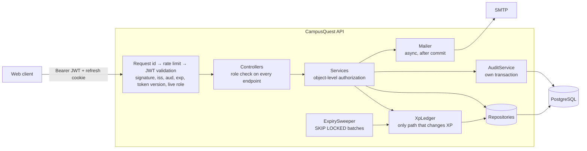

# CampusQuest

[](https://github.com/IYADH-74/CampusQuest/actions/workflows/ci.yml)
[](https://github.com/IYADH-74/CampusQuest/actions/workflows/codeql.yml)

**CampusQuest turns university life into a game.** Teachers set assignments for their cohorts, staff and
teachers publish campus-wide challenges (certifications, competitions, courses, events), and students earn
XP, level up, and unlock room for more challenges as they go.

This is v3: a ground-up rewrite of a second-year university project, built secure by default.
The original code is kept in [`legacy/`](legacy) along with a
[catalogue of its 20 vulnerabilities](docs/legacy-vulnerabilities.md), each closed in v3. For the story of
what changed and why, read **[Same app, two developers](docs/v2-vs-v3.md)**: the student's version and the
engineer's version, side by side.

## Highlights

- **A coherent domain.** Two quest kinds (mandatory *assignments*, optional *challenges*) and one
  participation state machine, with XP in an **append-only ledger**. See [docs/domain.md](docs/domain.md).
- **Hardened auth.** RS256 access tokens that are revoked instantly on disable or password change,
  **rotating refresh tokens with reuse detection** in `HttpOnly; SameSite=Strict` cookies, Argon2id, peppered
  single-use email codes, uniform responses that don't reveal which accounts exist, rate limiting, and an
  audit trail. See [docs/security.md](docs/security.md).
- **Authorization at three layers.** Deny-by-default URL rules, `@PreAuthorize` on every endpoint, and
  object-level checks in every service that return 404 instead of revealing that an object exists.
- **The database enforces invariants too.** Check constraints, a Postgres **exclusion constraint** so XP
  boosts can never overlap, optimistic locking, pessimistic locks for slot and capacity races, and
  `SKIP LOCKED` batch jobs that are safe to run on several instances at once.
- **Tested for real.** 69 tests, including Testcontainers integration tests against PostgreSQL 18 through the
  real security filter chain, and a concurrency test proving capacity holds when 8 students race for 1 spot.

## Stack

| Layer | Choice |
|---|---|
| Runtime | Java 25 (virtual threads), Spring Boot 4.2 |
| Web / security | Spring MVC, Spring Security 7 (OAuth2 resource server, Nimbus JOSE), RFC 9457 problem details |
| Data | PostgreSQL 18, Spring Data JPA (Hibernate 7), Flyway migrations, `ddl-auto=validate` |
| Ops | Multi-stage, non-root container image, Actuator health probes, ECS JSON logs, docker-compose with Mailpit |
| Quality | JUnit 5, Testcontainers, GitHub Actions CI, CodeQL (security-extended), Dependabot |

## Architecture



Code is organised by feature under `api/src/main/java/com/campusquest/`:
`auth`, `user`, `cohort`, `quest`, `progression`, `audit`, `mail`, `security`, `common`.

## Running locally

Requirements: Docker. To work on the API in an IDE you also need JDK 25.

```bash
# Everything in containers: API on :8080, Swagger UI at /swagger-ui.html, Mailpit inbox on :8025
docker compose --profile app up -d --build
```

The `dev` profile seeds demo data. Every seeded account uses the password `CampusQuest-dev-2026`:

| Email | Role |
|---|---|
| `admin@campusquest.dev` | Admin |
| `staff@campusquest.dev` | Staff |
| `teacher@campusquest.dev` | Teacher (teaches CS-2A and CS-2B) |
| `lina@`, `omar@`, `sara@`, `youssef@campusquest.dev` | Students |

To run the API from your IDE instead, start only the infrastructure with `docker compose up -d db mail`, then
run `CampusQuestApplication` with `SPRING_PROFILES_ACTIVE=dev`.

```bash
cd api && ./mvnw verify      # unit + integration tests (Docker must be running)
```

Production configuration is documented in [`.env.example`](.env.example). With the `prod` profile the API
refuses to start without real JWT keys and a verification pepper.

## API at a glance

All routes are under `/api/v1`. The full OpenAPI spec is at `/v3/api-docs` in dev.

| Area | Endpoints |
|---|---|
| Auth (public) | `POST auth/register`, `auth/verify-email`, `auth/verify-email/resend`, `auth/login`, `auth/refresh`, `auth/logout`, `auth/password/forgot`, `auth/password/reset` |
| Me | `GET/PATCH me`, `POST me/password`, `GET me/participations`, `GET me/xp-transactions` |
| Quests | `POST quests`, `GET quests/challenges`, `GET quests/authored`, `GET/PATCH/DELETE quests/{id}`, `POST quests/{id}/publish\|close\|cancel\|join`, `GET quests/{id}/participations` |
| Participations | `GET participations/{id}`, `POST participations/{id}/submit\|withdraw\|approve\|request-changes\|reject`, `GET reviews/pending` |
| Cohorts | `GET public/cohorts`, `GET/POST cohorts`, `GET/PATCH cohorts/{id}`, `POST cohorts/{id}/archive\|restore`, `PUT cohorts/{id}/teachers`, `GET cohorts/{id}/students` |
| Progression | `GET leaderboard`, `GET boosts` |
| Admin | `admin/users` (invite, edit, disable, enable, resend-invite), `admin/boosts`, `admin/students/{id}/xp-adjustments`, `admin/quests`, `admin/audit-events` |

## Roadmap

- [x] API v3: domain, security, tests, CI
- [ ] Web client (React + TypeScript, generated API client)
- [ ] Deployment
- [ ] CTF edition: the v2 vulnerabilities as a deliberately vulnerable training target
