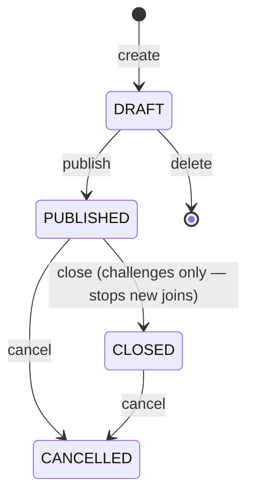
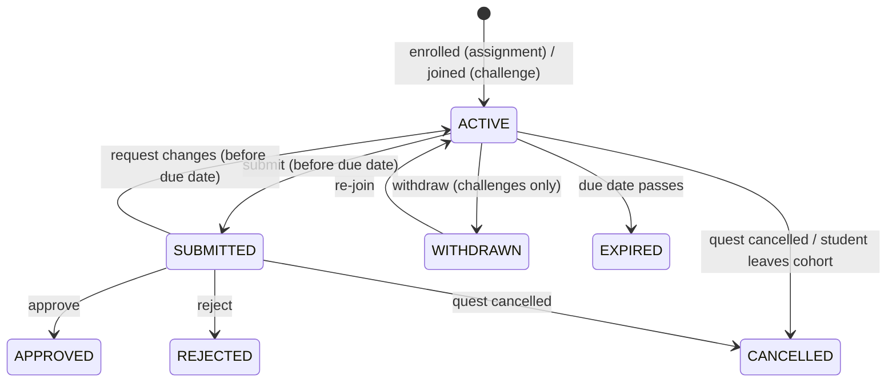
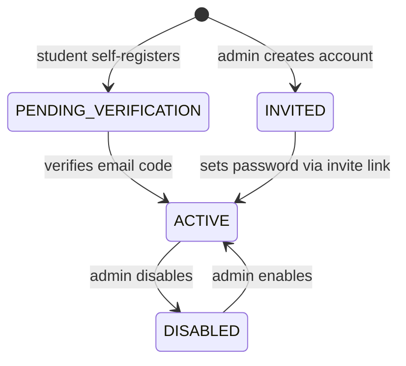

# CampusQuest domain model

CampusQuest turns university work into a game. Students earn **XP** by completing **quests**, XP drives
**levels**, and levels unlock more room to take on optional challenges. This document is the single
source of truth for the rules; the code in `api/` implements exactly this.

## Actors

| Role      | Who                     | What they do                                                                          |
|-----------|-------------------------|---------------------------------------------------------------------------------------|
| `STUDENT` | Enrolled learner        | Belongs to one cohort. Does assignments, joins challenges, earns XP.                  |
| `TEACHER` | Instructor              | Teaches one or more cohorts. Sets assignments for them, publishes challenges, reviews. |
| `STAFF`   | Campus/department staff | Runs cohorts and teaching rosters, publishes challenges (events, certifications…).    |
| `ADMIN`   | Platform operator       | Manages accounts, XP boosts and manual XP corrections. Reads everything, authors nothing. |

Admins deliberately **cannot** author or review quests (separation of duties): the person who can grant
themselves accounts should not also be able to grant XP through the normal game loop. Their XP lever is
the audited manual adjustment.

Roles never change after an account is created. Changing someone's role means creating a new account,
which keeps privilege escalation off the table.

## Cohorts

A **cohort** is a group of students who learn together (e.g. `CS-2A`). Each student belongs to at most
one cohort; a teacher can teach many cohorts (the *teaching roster*). Staff and admins manage cohorts and
rosters. Cohorts are archived, never deleted, so history stays intact.

## Quests

A quest is a unit of work worth XP. There are two kinds, and the difference between them is the whole
game design:

|                     | **Assignment** (mandatory)                          | **Challenge** (optional)                                    |
|---------------------|-----------------------------------------------------|-------------------------------------------------------------|
| Author              | Teacher, only for cohorts they teach                | Teacher or staff                                            |
| Audience            | One or more target cohorts                          | Every student on campus                                     |
| How students get it | Enrolled automatically when it is published         | Student opts in (**joins**)                                 |
| Category            | `COURSEWORK`                                        | `CERTIFICATION`, `COMPETITION`, `COURSE`, `EVENT`           |
| Due date            | Required                                            | Optional                                                    |
| Missed / rejected   | **XP penalty**                                      | No penalty                                                  |
| XP boost applies    | No                                                  | Yes                                                         |
| Limits              | None                                                | Optional capacity and minimum level; student slot limit     |

Every quest has a **tier** from 1 to 5 that sets its XP reward.

### Quest lifecycle

* **Draft**: fully editable and invisible to students.
* **Published**: only the title and description can change, the due date can only move later, and capacity can only grow.
  Publishing an assignment enrolls every active student in the target cohorts.
* **Closed**: a challenge that accepts no new participants. People already in can finish.
* **Cancelled**: open participations are cancelled with no XP effect. XP already awarded is kept.

## Participation

A **participation** is one student's attempt at one quest.

* A submission is text (up to 5,000 characters) plus an optional `https` link.
* Submitted work never expires. If the student got it in on time, it waits for review.
* **Who can review:** the quest's author always can. For challenges, any staff member can as well, since staff
  run campus-wide programmes. Nobody can review their own work, because students can't review at all.
* **Request changes** sends the work back with feedback. It is only allowed before the due date, so a
  student can't be stuck with a revision they can no longer submit.

## XP, levels, slots

### Rewards and penalties

| Tier | 1    | 2    | 3    | 4    | 5    |
|------|------|------|------|------|------|
| XP   | 2000 | 3000 | 4000 | 5000 | 6000 |

* **Approved**: the tier reward. For a challenge, multiply by the XP boost that was active **when the student
  submitted**, so a slow reviewer never costs the student their boost.
* **Assignment rejected or expired**: a flat penalty of 2000 XP.
* **XP never goes below 0.** A penalty larger than the balance takes the balance to 0, and the ledger records the
  amount actually deducted.

### The XP ledger

Every XP change is a row in an append-only ledger (`xp_transactions`) with its reason, source
participation, boost and actor. A student's balance is the sum of their ledger. The cached
`users.xp` column only exists so the leaderboard query stays fast, and it is updated in the same
transaction as the ledger row. A participation can be rewarded or penalised at most once (enforced by a
unique constraint), so a double-click or a retried request can't double-award.

Admins can make **manual adjustments** (positive or negative, with a mandatory note). These go through
the same ledger and are audited.

### Levels

Level is derived from total XP; there are 21 levels (0–20):

| Level | 0 | 1    | 2     | 3     | 4     | 5     | 6     | 7     | 8     | 9     | 10    |
|-------|---|------|-------|-------|-------|-------|-------|-------|-------|-------|-------|
| XP    | 0 | 5000 | 10500 | 16500 | 23000 | 30000 | 37500 | 45500 | 54500 | 64500 | 75500 |

| Level | 11    | 12     | 13     | 14     | 15     | 16     | 17     | 18     | 19     | 20     |
|-------|-------|--------|--------|--------|--------|--------|--------|--------|--------|--------|
| XP    | 87500 | 101000 | 116000 | 132500 | 150500 | 170000 | 191000 | 213500 | 237500 | 263500 |

### Challenge slots

A student can only have a limited number of challenges in flight (`ACTIVE` or `SUBMITTED`) at once.
Levelling up raises the limit:

| Level ≥ | 0 | 5 | 8 | 10 | 12 | 14 | 16 | 18 | 20 |
|---------|---|---|---|----|----|----|----|----|----|
| Slots   | 1 | 2 | 3 | 4  | 5  | 6  | 7  | 8  | 10 |

Assignments don't use slots. They are mandatory, so they can't crowd out anything.

### XP boosts

An admin can schedule a **boost**: a time window (at most 7 days) with a multiplier between 1.05× and 3×.
Boosts apply to challenges only, and windows can't overlap (enforced by a Postgres exclusion constraint).
They live in the database, so restarts and multiple instances don't affect them.

## Cohort membership changes

* When a student becomes active (verifies their email or accepts an invite), they are enrolled in every
  published assignment for their cohort that isn't yet due.
* When an admin moves a student to another cohort, the student's untouched (`ACTIVE`) work for assignments
  that only targeted the old cohort is cancelled with no penalty. They are then enrolled in the new cohort's
  open assignments. Submitted work stays in the review queue.

## Leaderboard

Active students are ranked by XP, campus-wide or per cohort, using SQL `rank()` so ties share a rank.
Only a display name (`First L.`), cohort, level and XP are shown.

## Lifecycle of accounts

Only students can self-register, and only into an existing, non-archived cohort. Staff, teachers and
admins are invited by an admin. They get an emailed link to choose their own password, so no admin ever
knows another user's password. The very first admin is bootstrapped from configuration the same way.
